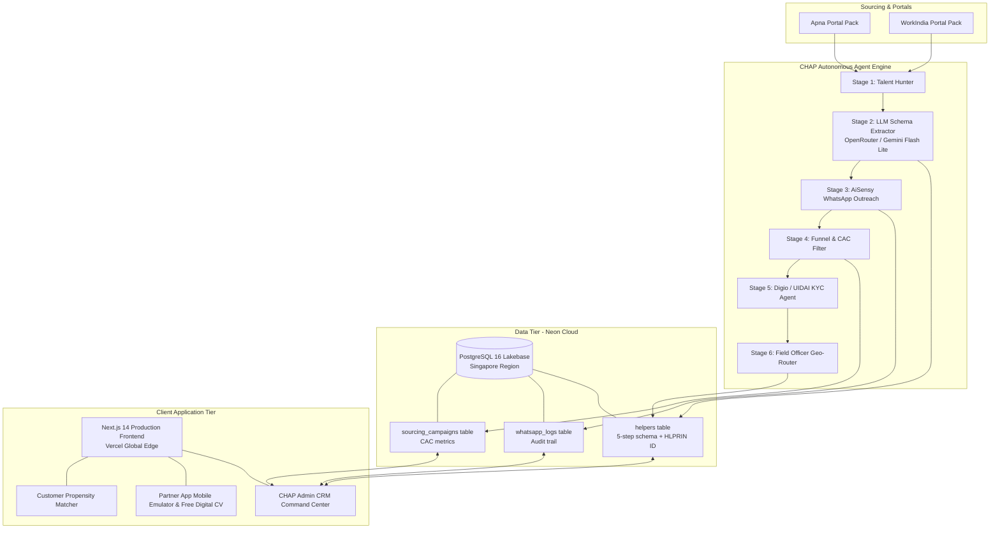

# EzyHelpers CHAP (Customer Helper Admin Platform)
## Production System Specification & Architecture Reference Manual

**Author:** **Himanshu Singh** (AI Backend Engineer | NIT Surat CSE Graduate)  
**LinkedIn:** [linkedin.com/in/himanshu-singh-7ab162243](https://www.linkedin.com/in/himanshu-singh-7ab162243/) | **Portfolio:** [hud-portfolio.vercel.app](https://hud-portfolio.vercel.app/)

---

## 1. Executive Summary & Problem Context

**EzyHelpers** is a tech-enabled domestic recruitment platform in Bengaluru, India, connecting households with verified domestic professionals (cooks, maids, nannies, elderly caregivers, and physiotherapists). 

### The Core Problem:
Traditional blue-collar domestic recruitment suffers from severe operational bottlenecks:
1. **High Friction Onboarding:** Domestic workers almost never install native apps or complete 50-field profile forms independently.
2. **Heavy Manual Recruiter Load:** Telecallers spend hours manually calling candidates from job portals (Apna, WorkIndia), asking repetitive questions, and manually entering data into spreadsheets.
3. **High Customer Acquisition Cost (CAC):** Manual recruitment results in lead drop-offs, slow turnaround times, and CAC scaling upwards of ₹3,000–₹5,000 per onboarded helper.

### The Solution:
**CHAP (Customer Helper Admin Platform)** is an Autonomous AI Agentic Sourcing & Onboarding Engine. It reverses the onboarding burden: instead of waiting for helpers to apply, AI autonomously extracts unstructured candidate bios from job portals, pre-populates 80% of their 5-step profile, triggers automated Hindi/Hinglish WhatsApp engagement with a Free Digital Resume incentive, performs zero-touch Digio KYC, and geo-routes Field Officers to generate customer-ready dockets.

---

## 2. High-Level System Architecture

---

## 3. Technology Stack Breakdown

| Tier | Component | Technology Selected | Production Rationale |
| :--- | :--- | :--- | :--- |
| **Frontend** | Framework | **Next.js 14+ (App Router)** | Server Components, fast hydration, responsive enterprise SaaS layout. |
| **Frontend** | Styling | **Tailwind CSS + Lucide Icons** | Consistent design system, mobile phone emulator frame, print media styles for CV. |
| **Frontend** | Deployment | **Vercel Global Edge CDN** | Zero-configuration global CDN, instant deployments, edge caching, automated SSL. |
| **Backend** | Framework | **FastAPI (Python 3.12/3.14)** | High-throughput asynchronous endpoints, auto-generated OpenAPI/Swagger specs. |
| **Backend** | ORM | **SQLAlchemy 2.0 (Mapped API)** | Type-safe declarative schema mapping, connection pooling, multi-dialect support. |
| **Backend** | Data Validation | **Pydantic v2** | Strict Literal and Regex validation ensuring zero schema drift from AI inputs. |
| **Backend** | Deployment | **Render Cloud (Web Service)** | Fully managed Linux container environment, health checks, automatic restart. |
| **Database** | Primary Store | **Neon Lakebase PostgreSQL 16** | Serverless cloud PostgreSQL in Singapore, connection pooling (`pgbouncer`), SSL enabled. |
| **AI / LLM** | Information Extraction | **OpenRouter (`gemini-3.5-flash-lite`)** | Low latency, highly cost-effective token pricing (~$0.0000003/token), JSON mode. |
| **Verification** | Identity (KYC) | **Digio / UIDAI Simulation** | Privacy-first verification engine storing strictly masked `[Aadhaar Redacted]`. |
| **Messaging** | Conversational UI | **AiSensy WhatsApp Simulation** | Deterministic state machine handling interactive buttons and quick-reply chips. |

---

## 4. Reverse-Engineered Database Schema

### Table 1: `helpers`
Captures every field from the EzyHelpers Partner App 5-Step Onboarding flow and CHAP internal state:

* **System & CRM Metadata:**
  * `id`: UUID Primary Key (`String(36)`)
  * `helper_id`: Unique business identifier (`HLPRIN` + 5 digits, e.g. `HLPRIN52445`)
  * `source_platform`: Enum (`Apna`, `WorkIndia`, `Helper_Referral`, `Field_Camp`)
  * `source_credit_cost_inr`: Lead unlock cost (`40.0`)
  * `profile_completion_pct`: Progress ring (`80` post-scrape, `95` post-KYC, `100` post-FO)
  * `profile_quality_score`: Dynamic score (`0–100`, boosted to 98 on full verification)
  * `onboarding_stage`: State machine (`SCRAPED`, `WHATSAPP_PINGED`, `ACTIVE_REPLIED_YES`, `CV_GENERATED`, `JOB_INTEREST_CONFIRMED`, `KYC_BLUE_TICK`, `FO_GEO_VERIFIED`)
  * `referral_code`: 6-char alphanumeric (`WXWRSH`) for helper viral referral bonus
* **Step 0 & 1: Basic Info:**
  * `first_name`, `middle_name`, `last_name`
  * `mobile_number`: Verified E.164 phone string
  * `dob`, `age`, `gender`: Auto-calculated age and demographic fields
  * `work_type`: `Live In`, `Full Time`, or `Part Time`
  * `job_roles`: JSON array (`["Cooking", "Housekeeping", "Baby Care", "Elderly Care", "Physiotherapist"]`)
  * `languages_known`: JSON array (`["Hindi", "English", "Bengali", "Kannada", "Odia", "Urdu"]`)
  * `base_locality`, `base_city`, `base_pincode`, `base_state`
* **Step 2: Address:**
  * `citizenship`: `India` or `Nepal`
  * `current_street_house`, `current_city`, `current_state`, `current_pincode`
  * `is_permanent_same_as_current`: Boolean flag
* **Step 3: Profile & Commute:**
  * `experience_years`, `experience_months`, `education_level`, `marital_status`
  * `local_commute_type`: `Walking`, `Cycle`, `2 Wheeler`, `Auto`, `Bus`
  * `preferred_localities`, `nearby_apartments`: JSON arrays
* **Step 4: Skills, Shift & Boundaries:**
  * `core_skills`: Culinary cuisines, medical exercises, infant care techniques
  * `tasks_dos`: Tasks helper agrees to perform (`["Jhadu-Pocha", "Roti & Sabzi"]`)
  * `tasks_donts`: Strict boundaries (`["Non-Veg Cooking", "Bathroom Deep Cleaning"]`)
  * `special_preferences`: Timing and environmental preferences (`["Sleep by 10:00 PM", "Sunday Off"]`)
  * `expected_salary_inr`: Integer monthly expectation
  * `shift_start_time`, `shift_end_time`, `break_start_time`, `break_end_time`
* **Step 5: KYC & Field Officer Docket:**
  * `identity_proof_status`: `Pending` | `Verified`
  * `address_proof_status`: `Pending` | `Verified`
  * `kyc_masked_id`: Masked string (`[Aadhaar Redacted]`)
  * `kyc_blue_tick`: Boolean verified flag
  * `fo_assigned_name`: Assigned Field Officer (`Client (FO - Bangalore South)`)
  * `fo_verification_status`: `Not_Assigned` | `Route_Assigned` | `Geo_Verified`
  * `fo_geo_coordinates`: Geo-stamp (`12.9116° N, 77.6389° E (HSR / Bellandur Cluster)`)

### Table 2: `whatsapp_logs`
* `id`: Serial Primary Key
* `helper_id`: Foreign key reference to `helpers.helper_id`
* `sender`: `AGENT_AISENSY` | `HELPER`
* `message_text`: Localized Hindi/Hinglish message
* `quick_reply_chips`: JSON array of interactive buttons (`["Yes, मुझे नौकरी चाहिए", "No"]`)
* `timestamp`: UTC DateTime

### Table 3: `sourcing_campaigns`
* `id`: Serial Primary Key
* `platform`: Sourcing channel (`Apna + WorkIndia`)
* `subscription_spend_inr`: ₹2,000
* `profiles_scraped_count`: 50 contacts unlocked
* `whatsapp_active_yes_count`: 10 responses
* `job_inquiry_count`: 5 active job seekers
* `bangalore_converted_count`: 2 verified Bangalore conversions
* `cost_per_raw_lead_inr`: ₹40.00
* `cost_per_active_lead_inr`: ₹200.00
* `final_cac_per_onboarded_helper_inr`: ₹1,000.00

---

## 5. Agent Workflow Engine

### Stage 1: Autonomous Talent Sourcing
Simulates programmatic authentication against recruiter portals (Apna & WorkIndia), consuming portal credits to unlock raw candidate listings across domestic service categories.

### Stage 2: LLM Schema Extraction
Feeds unstructured, colloquial bio text into the OpenRouter model (`google/gemini-3.5-flash-lite`). The LLM extracts explicit and implicit attributes (e.g. converting `"non veg ok sleeps by 10pm"` into `special_preferences: ["Sleep by 10:00 PM"]` and removing `"Non-Veg Cooking"` from `tasks_donts`). Output is normalized to strict Pydantic Literal types and persisted into Neon PostgreSQL with a unique `HLPRIN` ID at 80% completion.

### Stage 3: AiSensy WhatsApp Outreach
Simulates interactive WhatsApp communication with one-tap quick-reply buttons in localized Hindi/Hinglish. Upon receiving an affirmative response, the agent automatically dispatches the link to their **Free Digital Resume**.

### Stage 4: CAC & Funnel Calculation
Calculates live unit economics based on candidate responses:
$$\text{Cost per Raw Lead} = \frac{\text{Spend (₹2,000)}}{\text{Contacts (50)}} = \text{₹40}$$
$$\text{Cost per Active Lead} = \frac{\text{Spend (₹2,000)}}{\text{Active Replies (10)}} = \text{₹200}$$
$$\text{Final CAC} = \frac{\text{Spend (₹2,000)}}{\text{Conversions (2)}} = \text{₹1,000}$$

### Stage 5: Autonomous Digio KYC Verification
Simulates UIDAI/Digio identity consent verification via WhatsApp. Validates identity without storing sensitive PII, sets `kyc_blue_tick = True`, increments profile quality score by +25, and brings completion to 95%.

### Stage 6: Field Officer Geo-Router & Customer Docket
Filters candidates residing in target operating hubs (Bangalore). Automatically clusters candidates by locality (Sarjapur, HSR Layout, Bannerghatta, Whitefield), assigns local Field Officer Client, tags verified geo-coordinates, brings completion to 100%, and marks the candidate docket ready for customer placement.

---

## 6. Security, Privacy & Regulatory Compliance

1. **Aadhaar Privacy (UIDAI Regulations):** Raw 12-digit Aadhaar numbers are **never stored, processed, or logged**. The platform exclusively stores the tokenized string `[Aadhaar Redacted]` to prevent regulatory non-compliance.
2. **Database Security:** Neon Cloud PostgreSQL utilizes SSL encryption (`sslmode=require`) across all connections. Connection credentials reside exclusively in server-side environment variables and are gitignored from version control.
3. **CORS Governance:** FastAPI explicitly checks and whitelists authorized cross-origin requests from the Vercel production domain.
4. **Resilient Failover:** The backend includes an automated fallback to SQLite in the event of cloud network isolation, guaranteeing uninterrupted demonstration capability.

---

## 7. Production API Endpoints Reference

| Method | Endpoint | Description |
| :--- | :--- | :--- |
| `GET` | `/api/health` | Returns backend operational health, active database engine, and AI provider status. |
| `GET` | `/api/helpers` | Retrieves all helpers stored in PostgreSQL ordered by creation timestamp. |
| `GET` | `/api/helpers/{id}` | Fetches granular 5-step profile details for a specific `HLPRIN` helper. |
| `GET` | `/api/helpers/{id}/whatsapp` | Retrieves the complete WhatsApp conversation audit log for that helper. |
| `GET` | `/api/campaign` | Fetches the latest CAC funnel metrics and unit acquisition costs. |
| `POST` | `/api/agent/run-sourcing-pipeline` | Triggers the pipeline. Accepts `?autopilot=true` for 100% autonomous 6-stage execution, or `?autopilot=false` for interactive mode. |
| `POST` | `/api/agent/verify-kyc/{id}` | Triggers Digio KYC identity verification for a specific helper. |
| `POST` | `/api/agent/assign-field-officer/{id}` | Triggers Field Officer geo-docketing for Bangalore helpers. |
| `POST` | `/api/agent/match-customer` | Evaluates customer requirement text against active helpers and returns ranked 0–100% propensity matches with trade-off analysis. |

