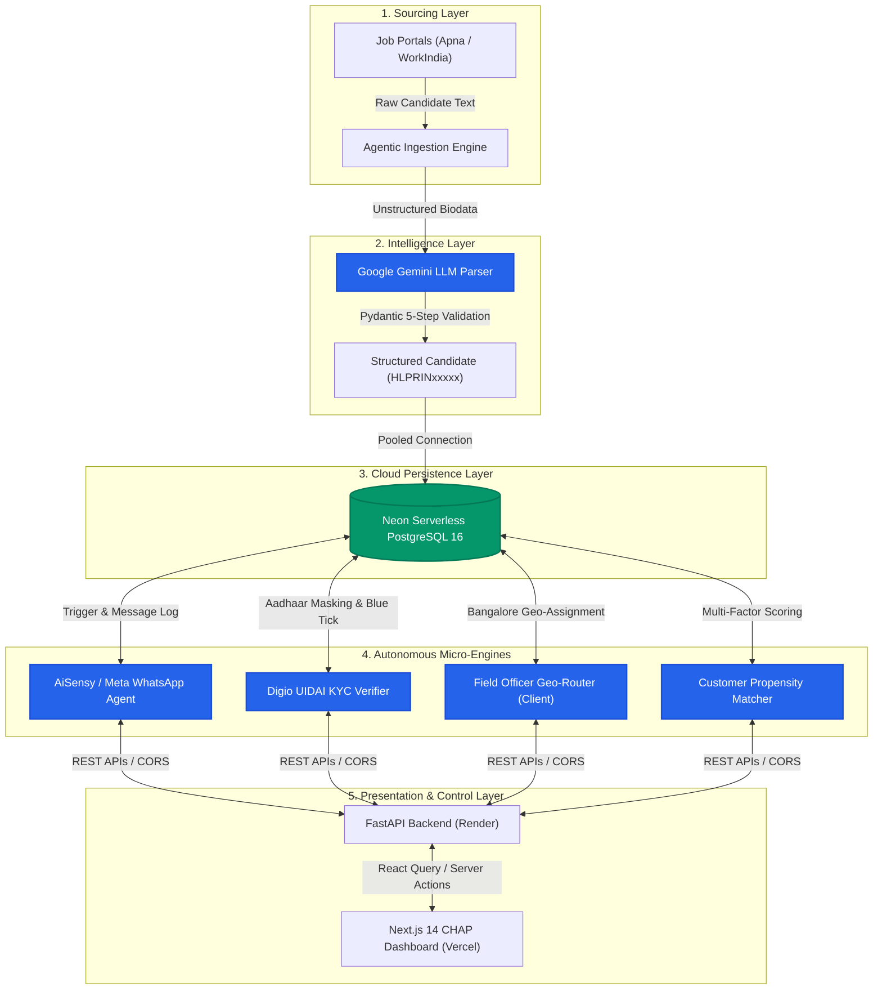
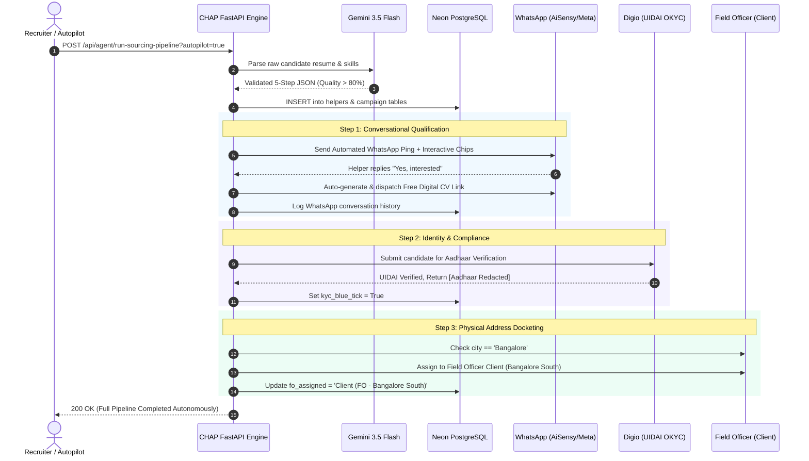
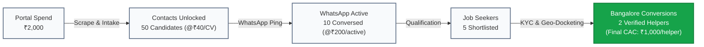

# EzyHelpers CHAP (Customer Helper Admin Platform)

> **Autonomous Agentic Supply Sourcing, LLM Schema Extraction, WhatsApp Lifecycle Automation, Digio KYC & Field Officer Geo-Routing Engine.**

[-blue.svg)](https://www.linkedin.com/in/himanshu-singh-7ab162243/)
[](https://www.linkedin.com/in/himanshu-singh-7ab162243/)
[](https://hud-portfolio.vercel.app/)
[](https://ezyhelper-chap.vercel.app)
[](https://ezyhelper-chap.onrender.com)
[](https://ezyhelper-chap.onrender.com/docs)
[](https://neon.tech)
[](https://openrouter.ai)

---

## 📌 Executive Summary

**EzyHelpers CHAP** is an end-to-end recruitment and supply automation platform built for India's domestic helper sector (cooks, housekeepers, nannies, babysitters, elder caregivers). 

Traditional domestic staff recruitment requires human recruiters to spend hours manually copying CVs from job portals, messaging candidates on WhatsApp, verifying paper Aadhaar cards, and matching profiles with employer requests. 

**CHAP automates this entire pipeline autonomously**:
1. **Sources & parses raw candidate listings** into structured 5-step profiles using Google Gemini LLMs.
2. **Engages candidates on WhatsApp** with automated interactive message chips and generates free digital resumes.
3. **Validates Government IDs via Digio** with strict UIDAI compliance and Aadhaar masking.
4. **Dispatches local Field Officers** for physical residence geo-verification.
5. **Calculates live CAC Funnels** (`₹2,000 spend -> 50 CVs -> 10 active -> 5 interested -> 2 Bangalore verified = ₹1,000/helper`).
6. **Matches helpers to customer requirements** via an algorithmic 0–100% propensity scoring engine.

---

## 🏛️ System Architecture

### 1. End-to-End Data & Integration Flow



---

### 2. Autonomous Verification & Onboarding Sequence



---

### 3. Customer Acquisition Cost (CAC) Funnel Progression



---

## 🚀 Key Features

### 1. Autonomous Sourcing & LLM Schema Extraction
* Ingests unstructured candidate text from Indian blue-collar job portals.
* Employs **Google Gemini 3.5 Flash-lite** (with a deterministic regex fallback) to extract 50+ fields conforming to the EzyHelpers 5-step partner registration standard:
  * Identity & Demographics (Name, Age, Gender, Indian Citizenship).
  * Work Preferences (Cooking, Housekeeping, Baby Care, Elderly Care).
  * Job Parameters (Full Time, Part Time, Live In, Expected Salary in INR).
  * Generates standard `HLPRINxxxxx` format helper IDs.

### 2. WhatsApp Conversational Lifecycle & Digital Resume
* Simulates the AiSensy / Meta Cloud API webhook flow:
  1. *Outbound Ping:* Candidate qualification invitation.
  2. *Inbound Reply:* Candidate confirmation ("Yes").
  3. *Free Digital CV Generation:* Auto-generates a shareable, branded resume link.
* Full conversation logs accessible via modal in the CRM dashboard.

### 3. Digio / UIDAI KYC Verification (Compliance First)
* Verifies government identity records.
* **Strict UIDAI Privacy Compliance:** Raw 12-digit Aadhaar numbers are never stored in the database. Numbers are masked into `[Aadhaar Redacted]` while stamping the verified candidate with the official **Blue Tick**.

### 4. Field Officer Geo-Docketing & Routing
* Automatically parses helper pin-codes and localities.
* Geo-routes Bangalore-based candidates directly to **Field Officer Client** (`Client (FO - Bangalore South)`) for in-person address verification and background check docketing.

### 5. Algorithmic Customer Propensity Matcher
* Real-time search engine matching helper profiles with employer job requests.
* Multi-factor scoring algorithm (0–100%):
  * **Role overlap** (Cooking, Housekeeping, Baby Care, etc.)
  * **Work type compatibility** (Full Time vs. Part Time vs. Live In)
  * **Locality & City proximity**
  * **Salary budget alignment** (INR)
  * **Trust boost** for KYC Blue Tick and Field Officer verified candidates.

### 6. Dual Operating Modes
* **⚡ Run Full Autopilot (Zero Clicks):** Executes scraping, LLM extraction, WhatsApp qualification, Digio KYC, and FO geo-routing completely autonomously.
* **▶ Interactive Mode (Manual Step-by-Step):** Allows human recruiters to inspect and click individual verification buttons (`WhatsApp`, `Digio KYC`, `Dispatch FO Client`, `Partner App`).

---

## 🛠️ Tech Stack

| Layer | Technology | Details |
| :--- | :--- | :--- |
| **Frontend** | **Next.js 14 (App Router)** | TypeScript, Tailwind CSS, Lucide React, Headless UI |
| **Backend API** | **FastAPI** | Python 3.11, Pydantic v2, SQLAlchemy 2.0, Uvicorn |
| **Database** | **Neon PostgreSQL 16** | Serverless Postgres in Singapore (`ap-southeast-1`) with pooling |
| **AI / LLM** | **OpenRouter / Gemini** | `google/gemini-3.5-flash-lite` with structured JSON output |
| **Deployments** | **Vercel & Render** | Auto-deploy from GitHub repository |

---

## 📡 REST API Reference

The backend exposes a full OpenAPI / Swagger interface at `https://ezyhelper-chap.onrender.com/docs`.

### Core Endpoints

#### 1. System Health
* **`GET /api/health`**
  * Returns backend status, active database dialect (`postgresql`), and Gemini LLM availability.

#### 2. Candidate Directory
* **`GET /api/helpers`**
  * Returns all helpers sorted by creation date with completion quality scores and verification statuses.
* **`GET /api/helpers/{helper_id}`**
  * Returns detailed profile for a specific helper.
* **`GET /api/helpers/{helper_id}/whatsapp`**
  * Returns full WhatsApp conversational audit trail for the candidate.

#### 3. Agentic Pipeline Triggers
* **`POST /api/agent/run-sourcing-pipeline`**
  * Query Param: `autopilot=true|false`
  * Ingests portal candidates, runs LLM parsing, writes to Neon DB, and (if `autopilot=true`) executes full KYC and Field Officer dispatch.
* **`POST /api/agent/verify-kyc/{helper_id}`**
  * Triggers Digio Aadhaar KYC verification, redacts Aadhaar number, and awards Blue Tick.
* **`POST /api/agent/assign-field-officer/{helper_id}`**
  * Validates Bangalore location and dockets the profile to Field Officer Client.
* **`POST /api/agent/match-customer`**
  * Request Body:
    ```json
    {
      "city": "Bangalore",
      "locality": "HSR Layout",
      "required_roles": ["Cooking"],
      "work_type": "Full Time",
      "budget_inr": 18000
    }
    ```
  * Returns ranked list of matching helpers with percentage match breakdown.

#### 4. Sourcing & CAC Funnel
* **`GET /api/campaign`**
  * Returns current campaign spend (`₹2,000`), unlocked contacts (`50`), active WhatsApp conversations (`10`), interested leads (`5`), and Bangalore conversions (`2`), yielding final CAC (`₹1,000/helper`).

---

## 🔄 POC vs. Real Production Transition

This project was built as an enterprise-grade Proof of Concept (POC). Below is the exact difference between the current setup and full commercial production:

| Component | Current POC Setup | Full Production Setup |
| :--- | :--- | :--- |
| **Database** | Live Neon PostgreSQL 16 | **Already Production Ready** (Enable PITR backups) |
| **Backend** | Live on Render Web Service | **Already Production Ready** (Upgrade to 24/7 dedicated compute) |
| **Frontend** | Live on Vercel | **Already Production Ready** (Add custom domain: `chap.ezyhelpers.com`) |
| **AI LLM** | Live OpenRouter / Gemini API | **Already Production Ready** (Drop in direct Gemini API key) |
| **Job Portals** | 10 realistic Apna/WorkIndia candidate samples | Connect Apna / WorkIndia Recruiter API or headless scraper |
| **WhatsApp** | Simulated AiSensy / Meta Webhook flow | Add Meta Business Token & registered phone number ID |
| **Aadhaar KYC** | Simulated Digio UIDAI API with strict Aadhaar redaction | Add Digio Client ID & Secret for live OTP / DigiLocker |
| **Field Officer** | Assigns Bangalore profiles to FO Client in DB | Connects to Field Officer mobile app / push notifications |

### Environment Variables Needed for Live Integrations
To switch from simulated to live integrations, simply update `.env` in the backend:
```bash
# Live Meta / AiSensy WhatsApp
WHATSAPP_API_URL="https://graph.facebook.com/v19.0/YOUR_PHONE_ID/messages"
WHATSAPP_BEARER_TOKEN="EAAxxxxxxxxx"

# Live Digio KYC API
DIGIO_CLIENT_ID="YOUR_DIGIO_CLIENT_ID"
DIGIO_CLIENT_SECRET="YOUR_DIGIO_SECRET"
DIGIO_ENVIRONMENT="production"
```

---

## 💻 Local Development Setup

### Prerequisites
* **Python 3.11+**
* **Node.js 18+** & **npm**
* **Git**

### 1. Clone the Repository
```bash
git clone https://github.com/Alieno1/ezyhelper-chap.git
cd ezyhelper-chap
```

### 2. Backend Setup
```bash
cd backend
python3 -m venv .venv
source .venv/bin/activate

pip install -r requirements.txt
cp .env.example .env
# Fill in your DATABASE_URL and GEMINI_API_KEY / OPENROUTER_API_KEY

uvicorn main:app --reload --port 8000
```
Backend will be available at `http://localhost:8000`.

### 3. Frontend Setup
```bash
cd ../frontend
npm install
npm run dev
```
Frontend will be available at `http://localhost:3000`.

---

## 🔒 Security & Compliance

* **Aadhaar Protection:** Conforms to UIDAI guidelines. No plain-text Aadhaar numbers are persisted in any database table or log file.
* **CORS Protection:** Configurable allowed origins preventing unauthorized API access.
* **Database Pooling:** Managed Neon serverless connection pool with SSL enforcement (`sslmode=require`).

---

## 👨‍💻 Author

**Himanshu Singh**  
*Computer Science Engineer (CSE) | NIT Surat Graduate*

* **LinkedIn:** [linkedin.com/in/himanshu-singh-7ab162243](https://www.linkedin.com/in/himanshu-singh-7ab162243/)
* **Portfolio:** [hud-portfolio.vercel.app](https://hud-portfolio.vercel.app/)

---

## 📄 License
This repository is proprietary software developed for **EzyHelpers**.

